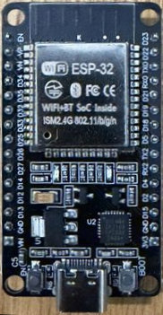
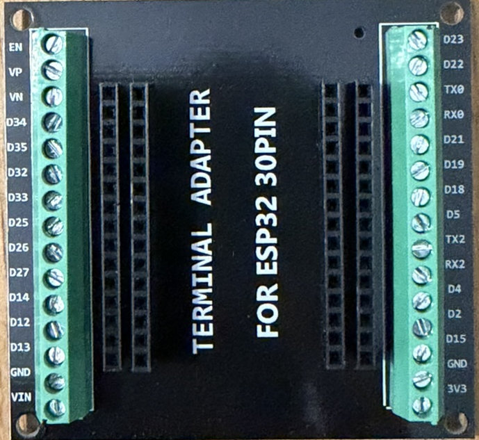

# ESP32 DevKit V1 + Home Assistant (ESPHome)

Documentația completă a proiectului pentru configurarea și utilizarea ESP32 DevKit V1 cu Home Assistant prin ESPHome.
Placă: **ESP32 DevKit V1** (`esp32doit-devkit-v1`), integrare prin **ESPHome**.

---

## 1. Prezentare generală

- 5 LED-uri colorate (galben, roșu, albastru, verde, alb) pe breadboard, comandate din Home Assistant prin WiFi
- LED-ul albastru de pe placă (GPIO2) ca al șaselea LED controlabil
- Senzor de lumină **HW-486** (fotorezistor, analogic)
- Senzor de temperatură **HW-498** (termistor NTC, analogic, convertit în °C)
- Buton fizic **HW-483** cu toggle inteligent (start/stop în funcție de stare)
- Buzzer activ **HW-512** (on/off) și buzzer pasiv **HW-508** (melodii RTTTL)
- Receptor IR **HW-490** (citește codurile unei telecomenzi) și emițător IR **HW-489** (le trimite)
- Dashboard custom cu `button-card` + `card_mod`

### Puncte cheie învățate

- **GPIO-urile ESP32 scot 3.3V, nu 5V.** LED-urile cu rezistențe calculate pentru 5V luminează mai slab la 3.3V, dar funcționează. Nu conecta niciodată 5V la un pin GPIO — pinii nu sunt toleranți la 5V.
- Pinul **VIN** dă ~5V (de la USB), dar e alimentare fixă, necontrolabilă din software.
- Notația de pe placă: **D23 = GPIO23** etc. Excepție: GPIO16/17 apar pe placă drept **RX2/TX2** (nu scrie D16/D17).
- Pini de evitat ca ieșiri: GPIO0, 2*, 12, 15 (boot/strapping), GPIO34-39 (doar intrare). (*GPIO2 e ok pentru LED-ul onboard.)
- Pentru citiri analogice cu WiFi activ: **doar ADC1** (GPIO32-39). ADC2 nu funcționează cu WiFi pornit.
- Senzorii se alimentează din **3V3**, nu din VIN — altfel ieșirea analogică poate depăși 3.3V și arde ADC-ul.
- LED-ul roșu de pe placă e LED-ul de power, legat în hardware — nu se poate stinge din software.

---

## 2. Instalare ESPHome

Două componente, cu roluri diferite:

| Componentă | Rol |
|---|---|
| **ESPHome Device Builder** (app, fost add-on) | Atelierul: editezi YAML, compilezi, instalezi firmware (OTA prin WiFi) |
| **ESPHome** (integrarea) | Puntea: HA vorbește cu placa și afișează entitățile |

### 2.1 ESPHome Device Builder (app)

Link direct (deschide pagina app-ului în Home Assistant-ul tău prin My Home Assistant; la prima folosire cere adresa instanței, ex. `http://homeassistant.local:8123`):
[Instalează ESPHome Device Builder](https://my.home-assistant.io/redirect/supervisor_addon/?addon=5c53de3b_esphome&repository_url=https%3A%2F%2Fgithub.com%2Fesphome%2Fhome-assistant-addon)

Sau manual:

1. Settings → Apps → Install app → **ESPHome Device Builder** → Install → Start → Show in sidebar.
2. Prima flash-are prin USB: **https://web.esphome.io** (Chrome, nu Safari) sau din Builder → New Device → "Plug into this computer".
3. Dacă placa a fost instalată prin web.esphome.io, în Builder apare ca *discovered* → **ADOPT** → se creează configurația editabilă.
4. Orice modificare de YAML: **SAVE + INSTALL → Wirelessly**. Save doar salvează fișierul; Install compilează și trimite firmware-ul pe placă.

App-urile există doar pe Home Assistant OS / Supervised. Pe HA Container/Core, Device Builder rulează separat (ex. Docker `ghcr.io/esphome/esphome`, port 6052).

### 2.2 ESPHome (integrarea)

Link direct (pornește adăugarea integrării):
[Adaugă integrarea ESPHome](https://my.home-assistant.io/redirect/config_flow_start/?domain=esphome)

De obicei HA găsește singur placa după prima flash-are (mDNS, aceeași rețea):

1. Settings → Devices & services → secțiunea **Discovered** → **ESPHome** (numele plăcii) → **Add** / Configure → Submit.
2. Dacă cere **encryption key**: e cheia din YAML-ul plăcii, `api:` → `encryption:` → `key:` (în Builder → placa → Edit).
3. Alege zona (Area) → Finish. Entitățile (LED-uri, senzori, buton, buzzer) apar sub dispozitiv.

Dacă placa nu apare la Discovered:

1. Settings → Devices & services → **Add integration** → caută **ESPHome**.
2. Host: IP-ul plăcii (din router sau din logurile din Builder) sau `<nume>.local`; Port: `6053`.
3. Encryption key ca mai sus → Submit.

După un Install wireless, integrarea preia automat entitățile noi la repornirea plăcii. Ca device-ul să poată apela acțiuni HA (`homeassistant.action`), activează în integrare: Configure → **Allow the device to perform Home Assistant actions**.

Notă: device-ul a rămas înregistrat în API ca `esphome-web-3053a0`, deci serviciile expuse au prefixul `esphome.esphome_web_3053a0_...` (chiar dacă entitățile au prefixul `esphome_esp32_devkitv1`, dat manual în HA). Redenumirea (`name:` din secțiunea `esphome:`) ar rupe entitățile și automatizările existente — nu merită.

---

## 3. Cablare

 

**Adaptorul cu borne** (*Terminal adapter for ESP32 30PIN*): placa se înfige în baretele negre din mijloc, iar firele modulelor se strâng în bornele cu șurub, fără breadboard. Etichetele bornelor sunt aceleași ca pe placă (inclusiv **RX2** = GPIO16 și **TX2** = GPIO17); are și borne pentru **3V3**, **GND** și **VIN**.

### LED-uri (toate pe rândul din dreapta)

| Pin placă | GPIO | LED |
|---|---|---|
| D23 | GPIO23 | galben |
| D22 | GPIO22 | roșu |
| D21 | GPIO21 | albastru |
| D19 | GPIO19 | verde |
| D18 | GPIO18 | alb |
| (onboard) | GPIO2 | LED albastru placă |

Circuit per LED: **GPIO → rezistență → anod (picior lung) → catod (picior scurt) → GND**.
Toate catozii pe linia comună (−) a breadboard-ului, legată la un GND al plăcii.
Polaritate: picior lung = + (spre pin), picior scurt = − (spre GND). Invers conectat nu se strică, doar nu luminează.

LED-urile RGB **HW-479** și **HW-478** sunt legate în paralel cu LED-urile roșu, verde și albastru: `R` → D22, `G` → D19, `B` → D21, `−` → GND. Se aprind odată cu acestea, fără configurație ESPHome proprie.

### Senzori și module (alimentare din 3V3 + GND, colțul dreapta-jos al plăcii)

| Modul | Ce e | Pin S | Note |
|---|---|---|---|
| HW-486 | Senzor lumină (fotorezistor) | **D34** (GPIO34) | 3 pini: S / mijloc=VCC / − |
| HW-498 | Senzor temperatură (termistor NTC) | **D35** (GPIO35) | idem |
| HW-483 | Buton apăsabil | **D33** (GPIO33) | pullup intern + inverted |
| HW-512 | Buzzer activ (sună singur la ON) | **D25** (GPIO25) | S + GND |
| HW-508 | Buzzer pasiv (PWM/melodii) | **D26** (GPIO26) | S + GND |
| HW-490 | Receptor IR | **RX2** (GPIO16) | 3 pini: S / mijloc=VCC / −; `inverted: true` |
| HW-489 | Emițător IR | **D4** (GPIO4) | `+` (la capăt) → 3V3; LED-ul e între `+` și S, deci `inverted: true` |
| SR602 | PIR, mișcare | **D27** (GPIO27) | `+` → 3V3; `pulldown: true` |
| HC-SR04 | Distanță ultrasunete | Trig **D13**, Echo **D14** | `Vcc` → 3V3, Echo direct; dacă nu merge, `Vcc` → VIN (5V) și Echo prin divizor 10k + 20k |
| MQ-7 | Gaz CO (orientativ) | AO → **VP** (GPIO36) | `VCC` → VIN (5V); AO prin divizor 10k + 20k, `multiply: 1.5` |
| SG90 | Servo | **D32** (GPIO32) | roșu → VIN (5V), maro → GND; ledc 50 Hz pe `channel: 2` |

Diferența buzzere: conectat direct la 3V3+GND, **activul sună continuu**, pasivul tace (sau un "tic").

### Verificare cu multimetrul (DC, sondă neagră pe GND)

| Punct de măsură | ON | OFF |
|---|---|---|
| Pin GPIO (ex. D23) | ~3.3V | ~0V |
| Anod LED (după rezistență) | ~1.8-2.2V (roșu/galben), ~2.7-3.2V (albastru/verde/alb) | 0V |

Curent prin LED = tensiunea pe rezistență ÷ valoarea rezistenței.
La LED-urile albastre/albe tensiunea de deschidere (~3V) e aproape de 3.3V → luminează mai slab; e normal, nu e defect.

---

## 4. Configurația ESPHome

| Fișier | Ce e |
|---|---|
| [device-builder.yaml](device-builder.yaml) | Configurația întreagă, salvată din ESPHome Device Builder (parolele sunt `!secret`): LED-uri, senzori, buton, buzzere, IR. Pe o placă nouă păstrează secțiunile generate la ADOPT (`esphome:`, `esp32:`, `api:`, `ota:`, `wifi:`) și adaugă restul |
| [esphome-leds.yaml](esphome-leds.yaml) | Doar cele 5 LED-uri, minimul pentru integrarea Alfabetul pe fire |

Fiecare LED e o ieșire GPIO plus o lumină `binary` care o folosește:

```yaml
output:
  - platform: gpio
    pin: GPIO23
    id: out_galben

light:
  - platform: binary
    name: "LED Galben"
    output: out_galben
```

Indentarea contează: `output:`, `light:` etc. încep de la marginea din stânga.

Note despre [device-builder.yaml](device-builder.yaml):

- `attenuation: 12db` extinde domeniul ADC la 0-3.3V (fără el saturează la ~1.1V).
- `internal: true` ascunde senzorii intermediari (volți, ohmi) din HA — ajunge doar temperatura în °C.
- `inverted: true` la buton: modulul trage S la GND la apăsare; inversat, apăsat = ON.
- Dacă temperatura e deplasată cu 2-5°C e normal pentru termistoare ieftine (ajustabil din `b_constant` sau filtru `offset`).
- Alternativă pentru GPIO2: `status_led: { pin: GPIO2 }` ca indicator de conexiune (clipește când nu e conectat la WiFi/HA) — secțiune separată, fără `output:` pe GPIO2.
- Test rapid buzzer pasiv: Developer Tools → Actions → `esphome.esphome_web_3053a0_play_rtttl` → `song_str: "beep:d=16,o=5,b=100:c6"`.
- Acțiunea `stop_rtttl` oprește melodia; o folosește „Sunet Morse” = RTTTL. E nouă: după ce o adaugi, reinstalează firmware-ul (Install).
- Pe o rețea aglomerată (ex. biserica, ~50 de telefoane): fără hotspot propriu (`ap:` / `captive_portal:`),
  `reboot_timeout: 5min` la `wifi:` și `api:` (implicit 15min), IP rezervat pe router (DHCP).
- Sunetul se oprește pe placă la pierderea WiFi (`wifi: on_disconnect`) sau a HA (`api: on_client_disconnected`):
  altfel comanda de oprire se pierde și buzzerul activ (HW-512) sună continuu.
- Placa cântă singură pe buzzerul pasiv starea WiFi: `c,g` în sus la conectare (și la pornire),
  `g,c` în jos la pierderea rețelei (`wifi: on_connect` / `on_disconnect`, merge și fără HA).
- IR: receptorul HW-490 scrie ultimul cod citit în „Cod IR primit (HW-490)” ca `PROTOCOL număr număr`:
  `NEC adresă comandă`, `SAMSUNG date biți`, `SONY date biți`, `RC5 adresă comandă`, `LG date biți`
  (ex. `NEC 0x00FF 0x45`). Emițătorul HW-489 primește același format: scrie-l în „Cod IR de trimis (HW-489)”
  și apasă „Trimite IR”, sau apelează acțiunea `esphome.esphome_web_3053a0_trimite_ir` cu `cod: "NEC 0x00FF 0x45"`.
  Codurile Sony sunt trimise de 3 ori (așa le cer televizoarele Sony).
  „Retrimite ultimul cod IR” trimite înapoi ce s-a citit: învață o tastă de pe telecomandă, apoi o repetă.
  Alte protocoale (aer condiționat etc.) nu ajung în senzor, dar apar în log (`dump: all`).
  Dacă emițătorul stă cu fața spre receptor, receptorul citește și ce trimite placa — un test bun.
  `trimite_ir` e o acțiune nouă: după Install, integrarea ESPHome o preia la repornirea plăcii.
- Diagnostic în HA: Semnal WiFi, Uptime, Retea WiFi, IP, Motiv repornire (`debug:`); cardul: [dashboard/dashboard-diagnostic.yaml](dashboard/dashboard-diagnostic.yaml).

---

## 5. Dashboard (Lovelace)

Necesită: **button-card** și **card_mod** (HACS). Entitățile au prefixul `esphome_esp32_devkitv1`.

Cardurile, salvate din dashboard (Edit dashboard → Add card → Manual):

| Fișier | Ce e |
|---|---|
| [dashboard/dashboard-leds.yaml](dashboard/dashboard-leds.yaml) | Caseta cu chenar (mod-card): cele 5 becuri, LED-ul plăcii, Start și Stop (grid cu 6 coloane, icon 22px, înălțime 40px), plus Mesaj și Progres dedesubt |
| [dashboard/dashboard-card.yaml](dashboard/dashboard-card.yaml) | Setările mesajului: Interval, Pauză între litere, Repetă după, Tip mesaj, Culoare Morse, Sunet Morse |
| [dashboard/dashboard-sensors.yaml](dashboard/dashboard-sensors.yaml) | Senzorii: lumină (HW-486), temperatură (HW-498), buton (HW-483), buzzer (HW-512), on/off pentru sunetul de pauză și semnalul Pauză |
| [dashboard/dashboard-diagnostic.yaml](dashboard/dashboard-diagnostic.yaml) | Diagnostic WiFi: semnal, rețea, IP, uptime, motiv repornire |
| [dashboard/tv.yaml](dashboard/tv.yaml) + [telecomanda-tv.svg](dashboard/telecomanda-tv.svg) | View-ul TV (masonry, fără HACS): telecomanda IR a TV-ului Sony KD-65XF7096 (HW-489), desenată ca SVG în stilul unei aplicații de telecomandă, cu zone transparente peste taste (picture-elements), să încapă pe un ecran de telefon: Sursă, „SONY” la centru, Power, cifrele 0–9, YouTube și Netflix ca plăcuțele de pe telecomanda Sony, cercul de navigare cu OK, jos VOL ± și CH ± cu ◄◄ Home ►► / Mute ►❙❙ Return / |◄◄ Stop ►►| între ele (►❙❙: atingere = Play, ținut apăsat = Pause); pune SVG-ul în `/config/www/`. Apoi ultimul cod citit (HW-490) și „Retrimite ultimul cod”, istoricul codurilor citite și un cod oarecare de trimis (HW-489). Codurile Sony vin din listele publice SIRC (Volum +/−, Netflix și YouTube citite de pe telecomandă); dacă o tastă nu merge, citește-o de pe telecomanda ta cu HW-490 |
| [dashboard/tablou-led.yaml](dashboard/tablou-led.yaml) + [telecomanda-led.svg](dashboard/telecomanda-led.svg) | View-ul Tablou LED (masonry, fără HACS): telecomanda cu 24 de taste a tabloului cu litere, desenată ca SVG (pus în `/config/www/`), cu o zonă de apăsat peste fiecare tastă (picture-elements), trimisă cu HW-489; protocol NEC, adresa 0xEF00, tasta n are comanda 0x(FF−n)(n): primele 8 citite cu HW-490, restul după regulă; plus istoricul codurilor citite |

Lecții de layout (ce NU a mers):

- `width` + `margin` + `aspect_ratio` pe button-card → cardurile se restrâng la zero, totul pare gol.
- `square: true` pe grid → celule pătrate uriașe, spațiu gol imens sub iconuri.
- `button-card` singur direct sub `mod-card` cu `height` fix → uneori se randează cu înălțime zero; soluția: un `grid` între ele.
- Soluția stabilă: fără `aspect_ratio`/`square`, înălțime explicită pe card (`height: 40px`), mărimea vizuală din `icon: width`.

---

## 6. Automatizare: buton fizic → toggle start/stop cu feedback sonor

Apăsarea butonului HW-483: dacă `sensor.esp32_devkitv1_progres` e `oprit` → Start (+ 3 note ascendente), altfel → Stop (+ 3 note descendente).

```yaml
alias: Toggle LEDs
description: Toggle LEDs
triggers:
  - trigger: state
    entity_id: binary_sensor.esphome_esp32_devkitv1_buton_hw_483
    to: "on"
actions:
  - if:
      - condition: state
        entity_id: sensor.esp32_devkitv1_progres
        state: oprit
    then:
      - action: esphome.esphome_web_3053a0_play_rtttl
        data:
          song_str: "start:d=16,o=5,b=140:c6,e6,g6"
      - action: button.press
        target:
          entity_id: button.esp32_devkitv1_start
    else:
      - action: esphome.esphome_web_3053a0_play_rtttl
        data:
          song_str: "stop:d=16,o=5,b=140:g6,e6,c6"
      - action: button.press
        target:
          entity_id: button.esp32_devkitv1_stop
mode: single
```

Capcane evitate:

- Trigger fără `to: "on"` s-ar declanșa și la eliberarea butonului (dublă execuție).
- Logica if/else se face în `actions:` (cu `if`/`choose`), nu în `conditions:` (alea doar blochează).
- Entitățile `button.*` nu au stări utile — nu pot fi folosite în condiții.
- Valoarea `oprit` trebuie să corespundă **literal** cu ce arată senzorul în Developer Tools → States.

### Sunete: pauza dintre litere și Morse

- **Pauza dintre litere** (Litere colorate): automatizarea
  [automations/sunet-pauza.yaml](automations/sunet-pauza.yaml) cântă un tic pe buzzerul pasiv la
  începutul fiecărei litere — odată cu pauza, sau la schimbarea literei când „Pauză între litere” e 0;
  se pornește / oprește din [dashboard-sensors.yaml](dashboard/dashboard-sensors.yaml).
  Pentru un sunet cât ține toată pauza: `binary_sensor.esp32_devkitv1_pauza` e `on` cât stau becurile
  stinse înaintea unei litere (cu pauza 0 rămâne `off`).
- **Morse**: se alege din `select.esp32_devkitv1_sunet_morse` — `Fără`, `Buzzer activ` (HW-512) sau
  `RTTTL` (HW-508). Îl face integrarea, nu o automatizare: sunetul pornește și se oprește în același
  moment cu becul, deci ține exact cât e becul aprins. RTTTL are nevoie de acțiunea `stop_rtttl` pe placă
  (secțiunea 4). Buzzerul și numele acțiunilor se schimbă din opțiunile integrării (Configure).

---

## 7. Depanare — rezumat

| Simptom | Cauză probabilă |
|---|---|
| LED nu luminează, pinul arată 3.3V | LED invers (rotește-l 180°) sau contact slab în breadboard |
| LED albastru/alb luminează slab | Normal la 3.3V: Vf (~3V) aproape de tensiunea pinului |
| Install wireless eșuează cu eroare de autentificare | Cheie/parolă OTA diferită în firmware-ul vechi → o flash-are prin USB, apoi OTA merge |
| Senzor cu valori haotice/fixe | Lipitură rece pe modul; verifică lipiturile de pe spate |
| Temperatura absurdă sau inversată | Schimbă `DOWNSTREAM` ↔ `UPSTREAM` la platforma `resistance` |
| Binary sensor inversat (ON când e liber) | `inverted: true` pe pin |
| Icon nou nu apare | Override local în HA (golește câmpul Icon al entității), Install nefăcut, cache browser (Cmd+Shift+R), sau typo în numele `mdi:` |
| Placa dispare din HA pe o rețea cu mulți clienți și nu revine | Router plin (limită de clienți / adrese DHCP): rezervare IP; placa repornește singură după 5 min fără WiFi sau HA |
| Buzzerul sună continuu după o deconectare | Comanda de oprire s-a pierdut; `on_disconnect` / `on_client_disconnected` din device-builder.yaml îl opresc pe placă |
| „Cod IR primit” nu se schimbă la apăsarea telecomenzii | Uită-te în log (`dump: all`): nimic → cablaj / pin S; apar coduri dar alt protocol decât NEC, Samsung, Sony, RC5, LG → nu ajung în senzor |
| LED-ul IR (HW-489) se vede prin camera telefonului aprins tot timpul | Pinul de emisie nu e `inverted: true`: semnalul ajunge la TV răsturnat (pornește uneori, dar nu se stinge, nu dă volum) |
| Aparatul nu reacționează la „Trimite IR” | Prea departe sau neîndreptat (LED-ul e slab la 3.3V); în log trebuie să apară `Trimis: ...`, altfel formatul codului e greșit (`Cod IR necunoscut`) |
| Serviciul rtttl nu e găsit | Numele real e după numele API al device-ului: `esphome.esphome_web_3053a0_play_rtttl` (verifică în Developer Tools → Actions) |

## 8. Idei de continuare

- LED-uri cu intensitate variabilă: `output: platform: ledc` + `light: platform: monochromatic` (PWM).
- Alimentare reală la 5V pentru LED-uri: ULN2003 sau tranzistori NPN (2N2222 + 1kΩ pe bază), comutând linia VIN.
- Calibrare senzor de lumină în procente: filtru `calibrate_linear` pe baza valorilor măsurate întuneric/lumină plină.
- Acțiune locală pe buton (merge fără WiFi/HA): `on_press: light.toggle: <id>` direct în ESPHome.
- Alarmă cu buzzerul activ: temperatură peste prag → `switch.turn_on` până la confirmare.
