<!--LLM_GENERATED_START-->
# Componente pentru ESP32 DevKit V1

Inventarul pieselor din cutie (senzori, module, rezistențe): ce face fiecare și cum
s-ar lega la placă, ca să alegi ce conectezi mai departe. Povestea completă a setup-ului (ESPHome, cablare,
depanare) e în [README.md](README.md).

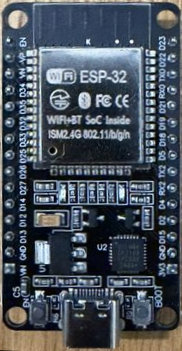 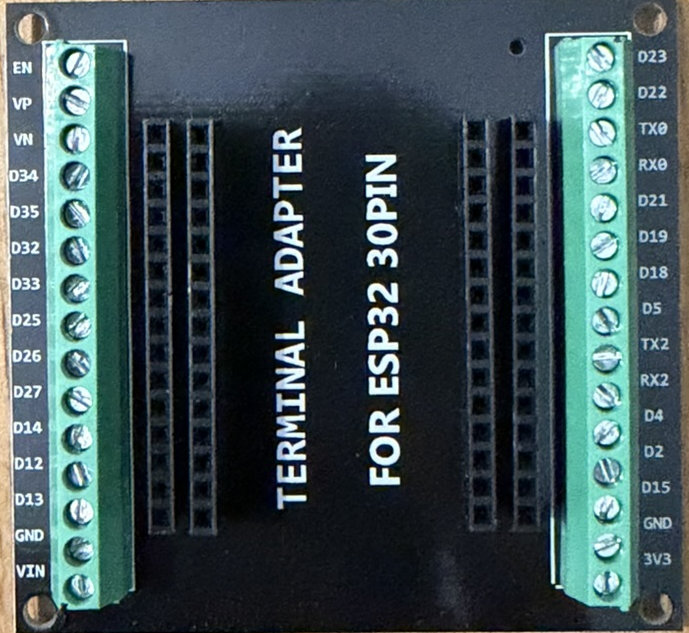

**Adaptorul cu borne** (*Terminal adapter for ESP32 30PIN*): placa se înfige în baretele negre din mijloc, iar firele modulelor se strâng în bornele cu șurub, fără breadboard. Etichetele bornelor sunt aceleași ca pe placă (inclusiv **RX2** = GPIO16 și **TX2** = GPIO17); are și borne pentru **3V3**, **GND** și **VIN**.

## Reguli de legare (pe scurt)

- Alimentează modulele din **3V3** + **GND**, nu din VIN (5V): ieșirea lor ar putea
  depăși 3.3V și ar arde pinul. Pinii GPIO nu suportă 5V.
- Semnal **analogic** → doar **ADC1**: GPIO32, 33, 34, 35, 36 (VP), 39 (VN). ADC2 nu
  merge cu WiFi pornit.
- **GPIO34-39** sunt doar intrări și nu au pull-up intern.
- Evită GPIO0, 12, 15 (pini de boot).
- Modulele care cer **5V** (MQ-135, MQ-7, HC-SR04) scot și semnal de 5V: pune un divizor
  de tensiune (ex. 10 kΩ + 20 kΩ) între ieșirea lor și pinul GPIO.

**Pini ocupați acum:** 2, 18, 19, 21, 22, 23 (LED-uri; pe 19, 21, 22 sunt și LED-urile RGB), 25, 26 (buzzere), 33 (buton),
34, 35, 36 (senzori analogici; 36 = MQ-7), 4, 16 (emițător și receptor IR), 13, 14 (HC-SR04),
27 (PIR SR602), 32 (servo SG90).
**Încă liberi și siguri:** 5, 17 (marcat TX2 pe placă) (intrare/ieșire), 39 (doar intrare, analogic).

Pe modulele negre cu 3 pini, `S` = semnal, `+` = 3V3, `−` = GND. Pe modulele roșii cu
4 pini: `A0` = ieșire analogică, `G` = GND, `+` = 3V3, `D0` = ieșire digitală (prag
reglat din potențiometrul albastru; LED-ul L2 se aprinde când pragul e depășit).

Codurile HW-xxx sunt cele tipărite pe plăcuțe. Numele și echivalentul KY-0xx vin din
lista kitului Geekcreit de 37 de module (sursă mai jos). Nu sunt un standard: unde
nu sunt sigur, scrie *(de verificat)*.

## Toate modulele

Cele marcate ✅ sunt deja legate. Configurația lor ESPHome e în
[device-builder.yaml](device-builder.yaml). Pinii propuși pentru celelalte sunt doar o
sugestie: dacă legi mai multe module odată, dă-i fiecăruia alt pin din lista de pini liberi.

Pozele sunt la aceeași scară (aprox. 4 px = 1 mm, măsurat după pasul de 2.54 mm al pinilor), deci lungimile se pot compara.

| Modul | Poză | Ce face / cum se conectează |
|---|---|---|
| ✅ **HW-486** (KY-018) Senzor de lumină (fotorezistor) | 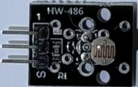 | Tensiune analogică ce variază cu lumina. **Legat:** `S` → **D34** (GPIO34), mijloc → 3V3, `−` → GND. ESPHome: `sensor: platform: adc`, `attenuation: 12db`. |
| ✅ **HW-498** (KY-013) Senzor de temperatură analogic (termistor NTC) | 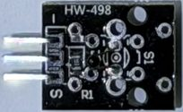 | Rezistența scade când crește temperatura. **Legat:** `S` → **D35** (GPIO35), mijloc → 3V3, `−` → GND. ESPHome: lanțul `adc` → `resistance` (10 kΩ) → `ntc` (B 3950) dă °C. |
| ✅ **HW-483** (KY-004) Buton apăsabil | 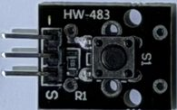 | Trage `S` la GND când e apăsat. **Legat:** `S` → **D33** (GPIO33), `−` → GND. ESPHome: `binary_sensor` cu `pullup: true` + `inverted: true`, debounce 10 ms. Pornește/oprește mesajul: [automations/toggle-leds-button.yaml](automations/toggle-leds-button.yaml). Entitatea: `binary_sensor.esphome_esp32_devkitv1_buton_hw_483`. |
| ✅ **HW-512** (KY-012) Buzzer activ | 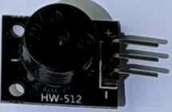 | Sună singur cât timp primește tensiune (un singur ton). **Legat:** `S` → **D25** (GPIO25), `−` → GND. ESPHome: `switch: platform: gpio`. |
| ✅ **HW-508** (KY-006) Buzzer pasiv | 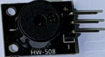 | Are nevoie de semnal PWM, așa că poate cânta note și melodii. **Legat:** `S` → **D26** (GPIO26), `−` → GND. ESPHome: `output: platform: ledc` + `rtttl`, apelat din HA cu `play_rtttl`. |
| **HW-503** (KY-028) Senzor digital de temperatură | 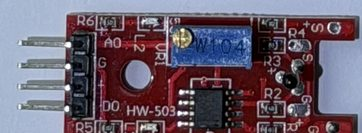 | Termistor + comparator: `D0` devine activ peste un prag de temperatură. `D0` → GPIO27 (`binary_sensor`) sau `A0` → GPIO32 (`adc`, valoare brută, necalibrată). |
| **HW-485** (KY-037) Microfon sensibil (mare) | 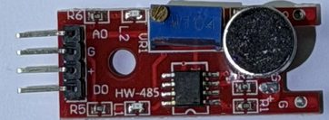 | Detectează sunete puternice (bătăi din palme). `D0` → GPIO27 (`binary_sensor`). `A0` → GPIO32 dă doar nivelul, nu e bun pentru înregistrat sunet. |
| **HW-496** (KY-038) Microfon (mic) | 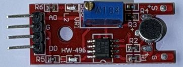 | La fel ca HW-485, mai puțin sensibil. Aceleași legături. |
| **HW-491** (KY-026) Senzor de flacără | 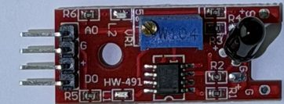 | Fotodiodă IR: simte o flacără sau o sursă IR din față. `D0` → GPIO27 (`binary_sensor`), `A0` → GPIO32 pentru intensitate. |
| **HW-494** (KY-036) Senzor de atingere | 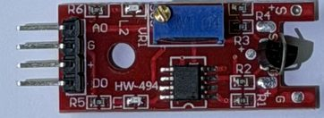 | Reacționează la atingerea piciorușului metalic. `D0` → GPIO27 (`binary_sensor`). |
| **HW-509** (KY-024) Senzor Hall liniar | 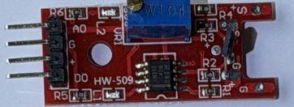 | Simte câmpul magnetic (un magnet apropiat). `A0` → GPIO32 pentru intensitate, `D0` → GPIO27 pentru prag. |
| **HW-500** (KY-031) Senzor de lovire (knock) | 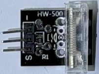 | Un arc într-un tub transparent: o lovitură închide contactul pentru o clipă. `S` → GPIO27 (`binary_sensor`, `pullup: true`). |
| **HW-513** (KY-002) Senzor de vibrație/șoc | 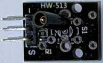 | Contact cu arc care se închide la scuturare. `S` → GPIO14 (`binary_sensor`). Impulsurile sunt foarte scurte, deci pune un filtru `delayed_off`. |
| **HW-497** (KY-021) Contact magnetic (reed) *(de verificat: cifra din mijloc e acoperită)* | 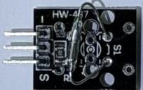 | Fiola de sticlă se închide lângă un magnet, ca un senzor de ușă. `S` → GPIO13 (`binary_sensor`, `pullup: true`). |
| **HW-511** (KY-033) Senzor de urmărire linie | 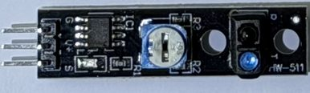 | LED IR + receptor orientate în jos: deosebesc o suprafață neagră de una albă, ca la roboții care urmăresc o linie. Pini `G` / `V+` / `S`. `S` → GPIO14 (`binary_sensor`). Sensibilitatea se reglează din potențiometru. |
| **HW-488** (KY-032) Senzor de obstacole IR *(codul nu se vede în poză, de verificat)* | 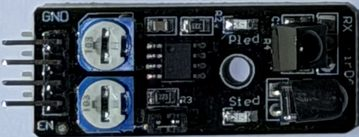 | LED IR + receptor: semnalează un obiect în față (distanța se reglează din potențiometre). Pini `GND` / `+` / `OUT` / `EN`. `OUT` → GPIO14 (`binary_sensor`, de obicei `inverted: true`). `EN` rămâne neconectat (jumperul îl ține activ). |
| ✅ **HW-489** (KY-005) Emițător infraroșu | 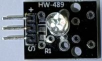 | LED IR care trimite coduri de telecomandă (TV, aer condiționat). **Legat:** `S` → **D4** (GPIO4), `+` (la capăt, nu la mijloc) → 3V3. LED-ul e între `+` și `S` și se aprinde când `S` e 0, deci în ESPHome pinul e `inverted: true`; fără `+` nu merge deloc. ESPHome: `remote_transmitter` + scriptul `trimite_ir`. Entitățile: `text.esphome_esp32_devkitv1_cod_ir_de_trimis_hw_489`, `button.esphome_esp32_devkitv1_trimite_ir_hw_489`. Bătaie mică (LED alimentat direct din pin): 1-2 m, îndreptat spre aparat. |
| ✅ **HW-490** (KY-022) Receptor infraroșu | 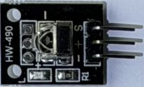 | Citește codurile unei telecomenzi. **Legat:** `S` → **RX2** (GPIO16; pe placă nu scrie D16), mijloc → 3V3, `−` → GND. ESPHome: `remote_receiver` cu `inverted: true` (ieșirea e activă pe 0); codul citit apare în `sensor.esphome_esp32_devkitv1_cod_ir_primit_hw_490` (ex. `NEC 0x00FF 0x45`) și în log. Dashboard: [dashboard/tv.yaml](dashboard/tv.yaml). |
| **HW-481** (KY-034) LED cu flash automat în 7 culori | 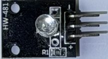 | Își schimbă singur culorile cât timp e alimentat. `S` → GPIO17 (TX2) (`switch` sau `light: binary`). |
| ✅ **HW-479** (KY-016) LED RGB | 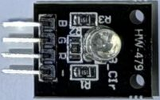 | Un LED cu 3 culori. Pini `R` / `G` / `B` / `−`. **Legat în paralel cu LED-urile de pe fire:** `R` → **D22** (GPIO22, roșu), `G` → **D19** (GPIO19, verde), `B` → **D21** (GPIO21, albastru), `−` → GND. Se aprinde odată cu firele 2, 4 și 3, deci nu are configurație ESPHome proprie. Pentru culori amestecate separat ar trebui mutat pe pini liberi, cu 3 × `output: platform: ledc` + `light: platform: rgb`. |
| ✅ **HW-478** (KY-009) LED RGB SMD (scrie „3_Clor” pe plăcuță) | 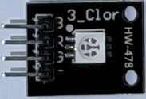 | La fel ca HW-479, cu un LED plat (SMD). **Legat la fel**, în paralel pe GPIO22 / GPIO19 / GPIO21. *(De verificat: dacă are rezistențe pe plăcuță; dacă nu, pune câte una de ~220 Ω pe fiecare culoare.)* |
| **HW-493** (KY-008) Laser | 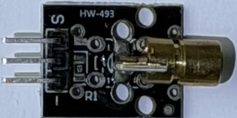 | Dioda laser roșie, aprinsă sau stinsă. `S` → GPIO5 (`light: binary`). Nu îl îndrepta spre ochi. |
| **HW-482** (KY-019) Releu 5V (10 A) | 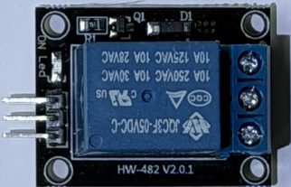 | Un comutator comandat: închide un circuit separat (bornele cu șurub). Bobina e de 5V, deci `+` → **VIN** (5V), `−` → GND, `S` → GPIO32 (`switch: platform: gpio`). *(De verificat: dacă releul comută cu doar 3.3V pe `S`.)* Nu lega 230V fără să știi ce faci. |
| **HW-040** (KY-040) Encoder rotativ cu buton | 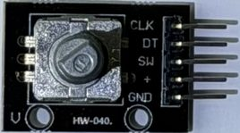 | Butonul se rotește fără capăt (pași stânga/dreapta) și se poate apăsa, de exemplu pentru volum sau intervalul mesajului. `CLK` → GPIO13 (GPIO16 e luat de receptorul IR), `DT` → GPIO17 (TX2), `SW` → GPIO27, `+` → 3V3, `GND`. ESPHome: `sensor: platform: rotary_encoder` + `binary_sensor` pentru `SW`. |
| **HW-499** (KY-027 *(de verificat)*) Lampă magică (comutator de înclinare + LED) | 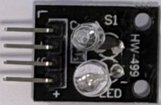 | Un comutator de înclinare (`S1`) și un LED pe aceeași plăcuță: înclini modulul și poți aprinde LED-ul. Pini `L` (LED) / `+` / `S` / `G`. `S` → GPIO27 (`binary_sensor`, `pullup: true`), `L` → GPIO5 (`light: binary`), `+` → 3V3. |
| **HW-495** (KY-020 *(de verificat)*) Comutator de înclinare cu bilă | 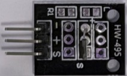 | O bilă într-un tub care închide contactul când modulul e înclinat într-o parte. Pini `−` / `+` / `S`. `S` → GPIO27 (`binary_sensor`, `pullup: true`, cu debounce). |
| **HW-501** (KY-017 *(de verificat)*) Comutator de înclinare (capsula albastră) cu LED | 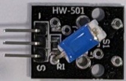 | Capsula albastră închide contactul când e înclinată; LED-ul de pe plăcuță arată starea. Pini `−` / `+` / `S`. `S` → GPIO27 (`binary_sensor`). |
| ✅ **SR602** Senzor PIR mini, detecție mișcare | 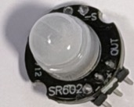 | Simte mișcarea unui om (căldură în mișcare), până la câțiva metri. **Legat:** `OUT` → **D27** (GPIO27), `+` → 3V3, `−` → GND. ESPHome: `binary_sensor` cu `device_class: motion` și `pulldown: true`. Ieșirea rămâne activă câteva secunde după ultima mișcare. După alimentare are nevoie de ~30 s să se stabilizeze. |
| ✅ **HC-SR04** Senzor de distanță cu ultrasunete | 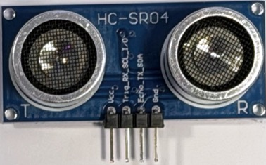 | Trimite un sunet de 40 kHz și măsoară ecoul: distanța de la 2 cm la ~4 m. **Legat:** `Trig` → **D13** (GPIO13), `Echo` → **D14** (GPIO14), `Gnd` → GND. Întâi încearcă `Vcc` → **3V3**, cu `Echo` direct pe D14, fără rezistențe (variantele noi merg și la 3.3V). Dacă distanța rămâne „necunoscut” sau sare aiurea, mută `Vcc` pe **VIN** (5V), dar **numai cu divizor** pe `Echo`: `Echo` → 10 kΩ → D14, și din D14 20 kΩ → GND (sau 270 Ω + 2 × 220 Ω, vezi [Rezistențe](#rezistențe)). Pe VIN fără divizor, ecoul de 5V arde pinul. ESPHome: `sensor: platform: ultrasonic`, în metri, cu filtru median. *(De verificat: plăcuța scrie `Trig_RX_SCL_I/O` și `Echo_TX_SDA`, deci e o variantă nouă care poate și UART/I2C; implicit merge ca HC-SR04 clasic.)* |
| **MQ-135** Senzor de calitate a aerului (gaze) | 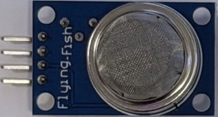 | Rezistența scade în prezența gazelor (amoniac, NOx, fum, benzen, CO2 doar orientativ). Pini `VCC` / `GND` / `DO` / `AO`. Încălzitorul are nevoie de **5V** (`VCC` → VIN, ~150 mA) și de câteva minute de încălzire (prima dată chiar ore). `AO` → GPIO32 **prin divizor** (`sensor: platform: adc`, valoare brută, necalibrată), `DO` → GPIO27 tot prin divizor (prag reglat din potențiometru). |
| ✅ **MQ-7** Senzor de monoxid de carbon (CO) | 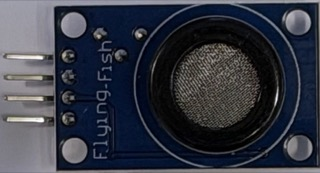 | Același fel de modul ca MQ-135, sensibil la CO. **Legat:** `VCC` → **VIN** (5V), `GND` → GND, `AO` → 10 kΩ → **VP** (GPIO36), și din VP 20 kΩ → GND (divizor), `DO` neconectat (pragul se face în HA). ESPHome: `adc` cu `multiply: 1.5`, dă tensiunea de pe `AO` (0-5V, mai mare = mai mult CO). Se încălzește: lasă-l câteva minute înainte să te uiți la valoare. Datasheet-ul cere încălzirea în cicluri 5V / 1.4V, iar modulul ține 5V constant, deci valoarea e doar orientativă: **nu ține loc de detector de CO pentru siguranță**. |
| **Display OLED 0.96"**, interfață I2C (SSD1306, 128×64) | 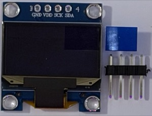 | Ecran mic monocrom pe care ESP32 poate scrie text sau valori (ex. litera curentă din mesaj). Bareta de pini vine separat și trebuie lipită. Pini `GND` / `VDD` / `SCK` / `SDA`, `VDD` → 3V3. Pinii I2C obișnuiți (21, 22) sunt ocupați de LED-uri, deci `i2c:` cu `sda: GPIO27`, `scl: GPIO14`. ESPHome: `display: platform: ssd1306_i2c`, `model: SSD1306 128x64`, adresa `0x3C`. |
| ✅ **SG90** (Micro Servo 9g) Servomotor | 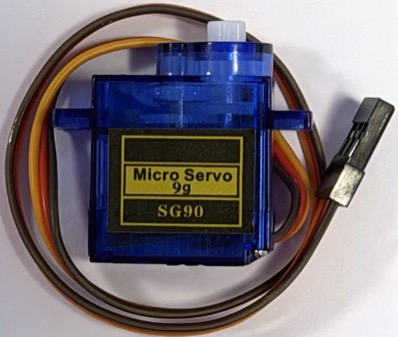 | Un motoraș care se rotește la un unghi dat (0-180°), de exemplu un indicator sau o barieră. **Legat:** maro → GND, roșu → **VIN** (5V), portocaliu (semnal) → **D32** (GPIO32). ESPHome: `output: platform: ledc` cu `frequency: 50 Hz` și `channel: 2` (alt timer decât buzzerul pasiv) + `servo:`; unghiul se dă din HA cu numărul „Servo (SG90)”. Când pornește trage curent mai mult, deci alimentează placa dintr-un USB bun. |

## Rezistențe

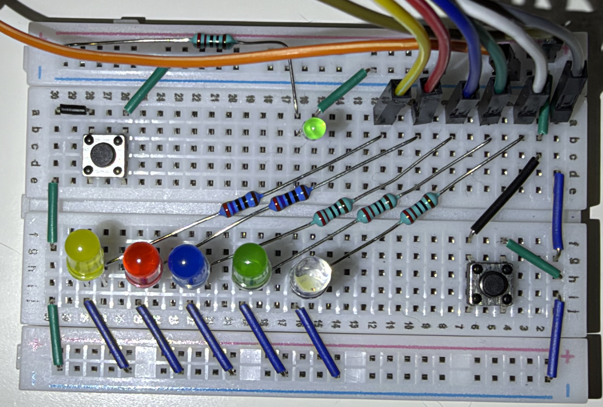

Pe breadboard, fiecare LED are în serie o rezistență care **limitează curentul**. Fără ea,
LED-ul ar trage cât curent poate: se arde el și poate strica și pinul GPIO (maxim ~20 mA
pe pin). Sunt două feluri, ambele cu peliculă metalică, cu 5 benzi, toleranță ±1%.
Se citesc dinspre capătul opus benzii maro de toleranță, care e puțin mai depărtată de celelalte:

| Corp | Poză | Benzi | Valoare | Unde e acum |
|---|---|---|---|---|
| albastru | 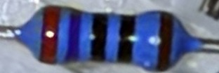 | roșu, violet, negru, negru, **maro** | **270 Ω** (2-7-0 × 1) | LED galben, LED roșu |
| verde-turcoaz | 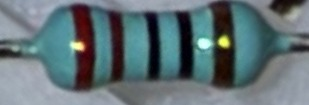 | roșu, roșu, negru, negru, **maro** | **220 Ω** (2-2-0 × 1) | LED albastru, LED verde, LED alb, LED-ul verde mic de sus |

**De ce două valori:** un LED „mănâncă” o tensiune fixă, *Vf*: ~2V roșu și galben,
~3V albastru, verde și alb. Rezistența primește restul, iar curentul e
`I = (U − Vf) / R`. Valorile sunt alese pentru **5V**, ca LED-urile să ia ~10 mA:

| LED-uri | Vf | R | la 5V | la 3.3V (pin GPIO) |
|---|---|---|---|---|
| galben, roșu | ~2.0V | 270 Ω | ~11 mA, luminos | ~5 mA, puțin mai slab |
| albastru, verde, alb | ~3.0V | 220 Ω | ~9 mA, luminos | ~1.4 mA, **slab** |

**La 3.3V, adică așa cum sunt legate acum:** pinii ESP32 scot doar 3.3V, deci LED-urile
merg pe coloana din dreapta. Nu se strică nimic, doar luminează mai slab. Albastrul,
verdele și albul rămân cu doar ~0.3V peste Vf, de aceea sunt cele mai slabe. Ca să fie mai
luminoase la 3.3V, pune rezistențe mai mici: **100 Ω** dă ~13 mA la roșu/galben și ~3 mA la
albastru/verde/alb. Nu coborî sub ~47 Ω.

**La 5V** ajung doar dacă un LED e alimentat din VIN, nu dintr-un pin GPIO. Așa ar sta
mereu aprins și n-ar mai putea fi comandat, decât printr-un tranzistor.

**Ca divizor de tensiune** (5V → 3.3V), cu rezistențe **de rezervă**, nu cu cele de pe LED-uri:
- **HC-SR04, `Echo`:** merge cu 270 Ω sus și 2 × 220 Ω în serie jos: 5V × 440 / 710 ≈
  **3.1V** pe D14. Invers (220 sus, 270 jos) dă ~2.8V, iar 220 sus cu 2 × 270 jos dă
  ~3.6V, **prea mult**.
- **MQ-7, `AO`:** **nu**. Un divizor atât de mic „încarcă” ieșirea senzorului, iar valoarea
  iese greșită. Pentru MQ-7 trebuie 10 kΩ + 20 kΩ, pe care se bazează și `multiply: 1.5`.

## Fișiere de copiat

| Fișier | Ce e |
|---|---|
| [device-builder.yaml](device-builder.yaml) | Configurația ESPHome completă de acum (LED-uri, senzori, buton, buzzere, IR), salvată din Device Builder |
| [esphome-leds.yaml](esphome-leds.yaml) | Doar cele 5 LED-uri, minimul pentru integrarea Alfabetul pe fire |
| [dashboard/dashboard-leds.yaml](dashboard/dashboard-leds.yaml) | Cardul cu becuri colorate, Start/Stop, Mesaj și Progres (button-card + card-mod) |
| [dashboard/dashboard-card.yaml](dashboard/dashboard-card.yaml) | Setările mesajului (Interval, Pauză între litere, Repetă după, Tip mesaj, Culoare Morse) |
| [dashboard/dashboard-sensors.yaml](dashboard/dashboard-sensors.yaml) | Senzorii: lumină, temperatură, buton, buzzer |
| [dashboard/tv.yaml](dashboard/tv.yaml) | View-ul TV: telecomanda Sony (HW-489), codurile IR citite (HW-490), un cod oarecare de trimis și istoricul |
| [automations/toggle-leds-button.yaml](automations/toggle-leds-button.yaml) | Butonul pornește/oprește mesajul, cu sunet |

Sursa codurilor HW: [Identifying Geekcreit modules from the 37-in-1 bundle](https://blog.renttalent.dk/2020/12/identifying-geekcriet-modules-from-37.html).
<!--LLM_GENERATED_END-->
