<!--LLM_GENERATED_START-->
# Senzori și module pentru ESP32 DevKit V1

Inventarul modulelor din cutie: ce face fiecare și cum s-ar lega la placă, ca să
alegi ce conectezi mai departe. Povestea completă a setup-ului (ESPHome, cablare,
depanare) e în [esp32-devkitv1-home-assistant.md](esp32-devkitv1-home-assistant.md).

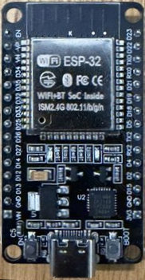

## Reguli de legare (pe scurt)

- Alimentează modulele din **3V3** + **GND**, nu din VIN (5V): ieșirea lor ar putea
  depăși 3.3V și ar arde pinul. Pinii GPIO nu suportă 5V.
- Semnal **analogic** → doar **ADC1**: GPIO32, 33, 34, 35, 36 (VP), 39 (VN). ADC2 nu
  merge cu WiFi pornit.
- **GPIO34-39** sunt doar intrări și nu au pull-up intern.
- Evită GPIO0, 12, 15 (pini de boot).

**Pini ocupați acum:** 2, 18, 19, 21, 22, 23 (LED-uri; pe 19, 21, 22 sunt și LED-urile RGB), 25, 26 (buzzere), 33 (buton),
34, 35 (senzori analogici).
**Încă liberi și siguri:** 4, 5, 13, 14, 16, 17, 27, 32 (intrare/ieșire), 36, 39
(doar intrare, analogic).

Pe modulele negre cu 3 pini, `S` = semnal, `+` = 3V3, `−` = GND. Pe modulele roșii cu
4 pini: `A0` = ieșire analogică, `G` = GND, `+` = 3V3, `D0` = ieșire digitală (prag
reglat din potențiometrul albastru; LED-ul L2 se aprinde când pragul e depășit).

Codurile HW-xxx sunt cele tipărite pe plăcuțe. Numele și echivalentul KY-0xx vin din
lista kitului Geekcreit de 37 de module (sursă mai jos). Nu sunt un standard: unde
nu sunt sigur, scrie *(de verificat)*.

## Toate modulele

Cele marcate ✅ sunt deja legate. Configurația lor ESPHome e în
[esphome-full.yaml](esphome-full.yaml). Pinii propuși pentru celelalte sunt doar o
sugestie: dacă legi mai multe module odată, dă-i fiecăruia alt pin din lista de pini liberi.

Pozele sunt la aceeași scară (aprox. 4 px = 1 mm, măsurat după pasul de 2.54 mm al pinilor), deci lungimile se pot compara.

| Modul | Poză | Ce face / cum se conectează |
|---|---|---|
| ✅ **HW-486** (KY-018) Senzor de lumină (fotorezistor) | 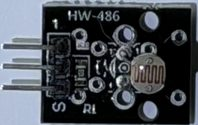 | Tensiune analogică ce variază cu lumina. **Legat:** `S` → **D34** (GPIO34), mijloc → 3V3, `−` → GND. ESPHome: `sensor: platform: adc`, `attenuation: 12db`. |
| ✅ **HW-498** (KY-013) Senzor de temperatură analogic (termistor NTC) | 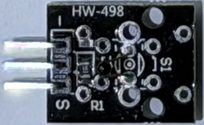 | Rezistența scade când crește temperatura. **Legat:** `S` → **D35** (GPIO35), mijloc → 3V3, `−` → GND. ESPHome: lanțul `adc` → `resistance` (10 kΩ) → `ntc` (B 3950) dă °C. |
| ✅ **HW-483** (KY-004) Buton apăsabil | 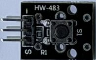 | Trage `S` la GND când e apăsat. **Legat:** `S` → **D33** (GPIO33), `−` → GND. ESPHome: `binary_sensor` cu `pullup: true` + `inverted: true`, debounce 10 ms. Pornește/oprește mesajul: [automations/toggle-leds-button.yaml](automations/toggle-leds-button.yaml). Entitatea: `binary_sensor.office_esphome_esp32_devkitv1_buton_hw_483` (până în octombrie 2026 numită greșit `…_buton_hw_843`). |
| ✅ **HW-512** (KY-012) Buzzer activ | 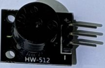 | Sună singur cât timp primește tensiune (un singur ton). **Legat:** `S` → **D25** (GPIO25), `−` → GND. ESPHome: `switch: platform: gpio`. |
| ✅ **HW-508** (KY-006) Buzzer pasiv | 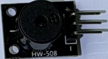 | Are nevoie de semnal PWM, așa că poate cânta note și melodii. **Legat:** `S` → **D26** (GPIO26), `−` → GND. ESPHome: `output: platform: ledc` + `rtttl`, apelat din HA cu `play_rtttl`. |
| **HW-503** (KY-028) Senzor digital de temperatură | 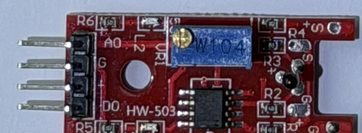 | Termistor + comparator: `D0` devine activ peste un prag de temperatură. `D0` → GPIO27 (`binary_sensor`) sau `A0` → GPIO32 (`adc`, valoare brută, necalibrată). |
| **HW-485** (KY-037) Microfon sensibil (mare) | 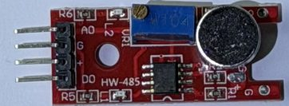 | Detectează sunete puternice (bătăi din palme). `D0` → GPIO27 (`binary_sensor`). `A0` → GPIO32 dă doar nivelul, nu e bun pentru înregistrat sunet. |
| **HW-496** (KY-038) Microfon (mic) | 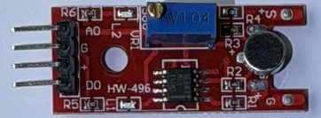 | La fel ca HW-485, mai puțin sensibil. Aceleași legături. |
| **HW-491** (KY-026) Senzor de flacără | 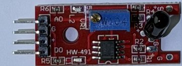 | Fotodiodă IR: simte o flacără sau o sursă IR din față. `D0` → GPIO27 (`binary_sensor`), `A0` → GPIO32 pentru intensitate. |
| **HW-494** (KY-036) Senzor de atingere | 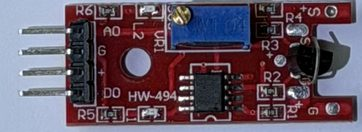 | Reacționează la atingerea piciorușului metalic. `D0` → GPIO27 (`binary_sensor`). |
| **HW-509** (KY-024) Senzor Hall liniar | 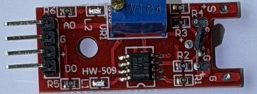 | Simte câmpul magnetic (un magnet apropiat). `A0` → GPIO32 pentru intensitate, `D0` → GPIO27 pentru prag. |
| **HW-500** (KY-031) Senzor de lovire (knock) | 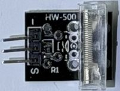 | Un arc într-un tub transparent: o lovitură închide contactul pentru o clipă. `S` → GPIO27 (`binary_sensor`, `pullup: true`). |
| **HW-513** (KY-002) Senzor de vibrație/șoc | 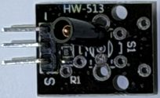 | Contact cu arc care se închide la scuturare. `S` → GPIO14 (`binary_sensor`). Impulsurile sunt foarte scurte, deci pune un filtru `delayed_off`. |
| **HW-497** (KY-021) Contact magnetic (reed) *(de verificat: cifra din mijloc e acoperită)* | 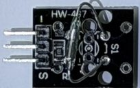 | Fiola de sticlă se închide lângă un magnet, ca un senzor de ușă. `S` → GPIO13 (`binary_sensor`, `pullup: true`). |
| **HW-511** (KY-033) Senzor de urmărire linie | 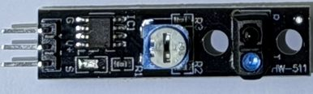 | LED IR + receptor orientate în jos: deosebesc o suprafață neagră de una albă, ca la roboții care urmăresc o linie. Pini `G` / `V+` / `S`. `S` → GPIO14 (`binary_sensor`). Sensibilitatea se reglează din potențiometru. |
| **HW-488** (KY-032) Senzor de obstacole IR *(codul nu se vede în poză, de verificat)* | 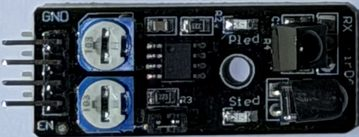 | LED IR + receptor: semnalează un obiect în față (distanța se reglează din potențiometre). Pini `GND` / `+` / `OUT` / `EN`. `OUT` → GPIO14 (`binary_sensor`, de obicei `inverted: true`). `EN` rămâne neconectat (jumperul îl ține activ). |
| **HW-489** (KY-005) Emițător infraroșu | 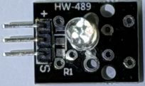 | LED IR care trimite coduri de telecomandă (TV, aer condiționat). `S` → GPIO4. ESPHome: `remote_transmitter`. |
| **HW-490** (KY-022) Receptor infraroșu | 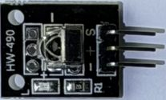 | Citește codurile unei telecomenzi. `S` → GPIO16. ESPHome: `remote_receiver` (în log se văd codurile primite). |
| **HW-481** (KY-034) LED cu flash automat în 7 culori | 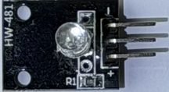 | Își schimbă singur culorile cât timp e alimentat. `S` → GPIO17 (`switch` sau `light: binary`). |
| ✅ **HW-479** (KY-016) LED RGB | 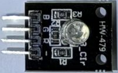 | Un LED cu 3 culori. Pini `R` / `G` / `B` / `−`. **Legat în paralel cu LED-urile de pe fire:** `R` → **D22** (GPIO22, roșu), `G` → **D19** (GPIO19, verde), `B` → **D21** (GPIO21, albastru), `−` → GND. Se aprinde odată cu firele 2, 4 și 3, deci nu are configurație ESPHome proprie. Pentru culori amestecate separat ar trebui mutat pe pini liberi, cu 3 × `output: platform: ledc` + `light: platform: rgb`. |
| ✅ **HW-478** (KY-009) LED RGB SMD (scrie „3_Clor” pe plăcuță) | 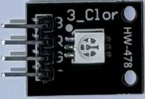 | La fel ca HW-479, cu un LED plat (SMD). **Legat la fel**, în paralel pe GPIO22 / GPIO19 / GPIO21. *(De verificat: dacă are rezistențe pe plăcuță; dacă nu, pune câte una de ~220 Ω pe fiecare culoare.)* |
| **HW-493** (KY-008) Laser | 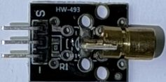 | Dioda laser roșie, aprinsă sau stinsă. `S` → GPIO5 (`light: binary`). Nu îl îndrepta spre ochi. |
| **HW-482** (KY-019) Releu 5V (10 A) | 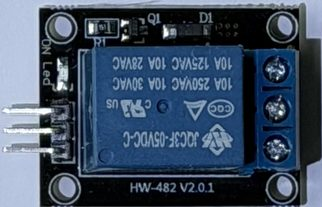 | Un comutator comandat: închide un circuit separat (bornele cu șurub). Bobina e de 5V, deci `+` → **VIN** (5V), `−` → GND, `S` → GPIO32 (`switch: platform: gpio`). *(De verificat: dacă releul comută cu doar 3.3V pe `S`.)* Nu lega 230V fără să știi ce faci. |
| **HW-040** (KY-040) Encoder rotativ cu buton | 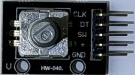 | Butonul se rotește fără capăt (pași stânga/dreapta) și se poate apăsa, de exemplu pentru volum sau intervalul mesajului. `CLK` → GPIO16, `DT` → GPIO17, `SW` → GPIO27, `+` → 3V3, `GND`. ESPHome: `sensor: platform: rotary_encoder` + `binary_sensor` pentru `SW`. |

## Fișiere de copiat

| Fișier | Ce e |
|---|---|
| [esphome-full.yaml](esphome-full.yaml) | Configurația ESPHome completă de acum (LED-uri, senzori, buton, buzzere) |
| [esphome-leds.yaml](esphome-leds.yaml) | Doar cele 5 LED-uri, minimul pentru integrarea Alfabetul pe fire |
| [dashboard-leds.yaml](dashboard-leds.yaml) | Cardul cu becuri colorate (button-card + card-mod) |
| [dashboard-card.yaml](dashboard-card.yaml) | Cardul de control al mesajului (Mesaj, Interval, Start/Stop) |
| [automations/toggle-leds-button.yaml](automations/toggle-leds-button.yaml) | Butonul pornește/oprește mesajul, cu sunet |

Pozele originale: `sensors/sensors-colection-1 (v2).jpeg`, `sensors/sensors-colection-2 (v2).jpeg`.
Sursa codurilor HW: [Identifying Geekcreit modules from the 37-in-1 bundle](https://blog.renttalent.dk/2020/12/identifying-geekcriet-modules-from-37.html).
<!--LLM_GENERATED_END-->
